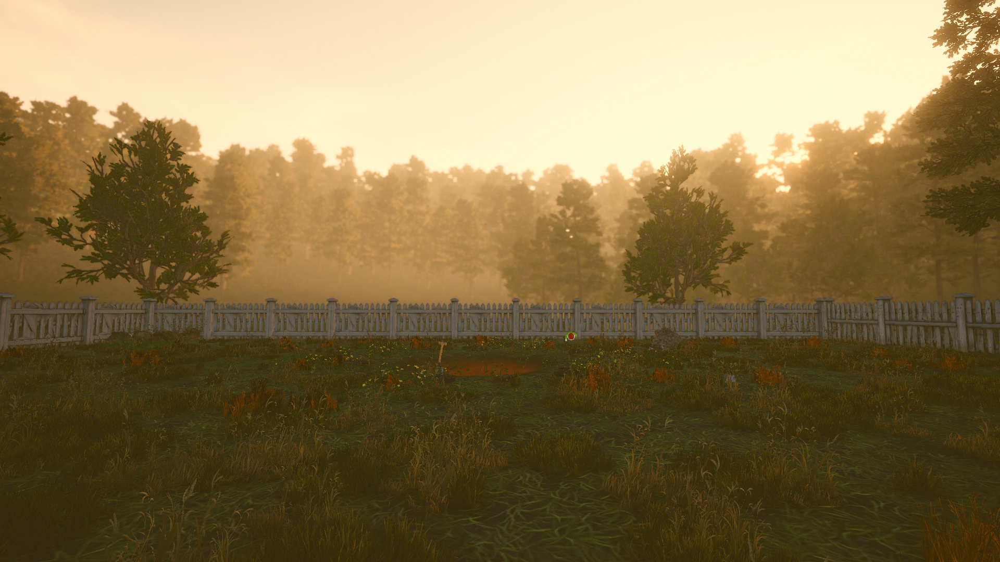
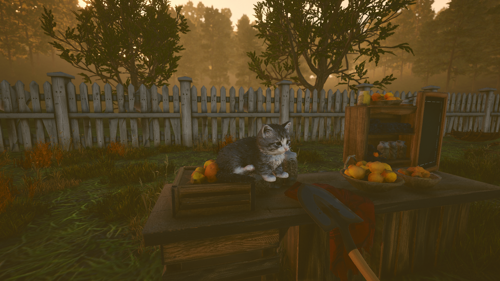
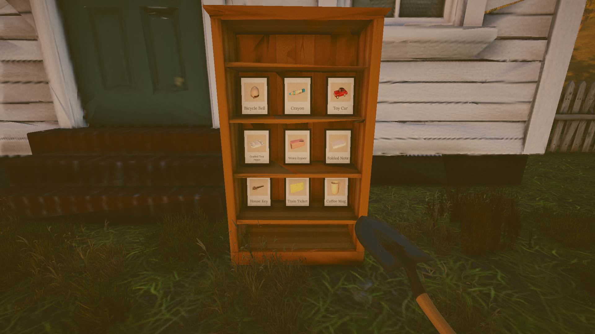

# DigIn

*Let's dig in.* A first-person digging game made in a weekend for MadHacks 2026.

You start in a backyard at golden hour with an old spade stuck in the soft ground. It plays like a digging game: dig, find minerals, sell them to the family cat who keeps a little shop by the back door, buy a better spade, dig deeper. But along a hidden, winding path under the yard lie the things you once passed by without noticing: a bicycle bell, a crayon, a folded note, a house key, a coffee mug. Childhood dirt, school-days clay, the stone of growing up. At the very bottom is today, and a blank page.

## Controls

| Key | |
|---|---|
| WASD | walk |
| Mouse | look |
| Hold left click | dig (once you have taken the spade) |
| Left click | pick up a memory, close a card or letter |
| E | pick things up (the spade, minerals), pet the cat, open the shop |
| R | up to the surface, and back down to where you were |
| Esc | close the shop, a card or a letter; otherwise the menu (Resume, How to Play, Settings, Quit) |

## Run the Windows build

Download `DigIn-Windows.zip` from the [v1.0 release](https://github.com/starjune77/madhacks2026-dig-in/releases/tag/v1.0), unzip it anywhere and run `DigIn.exe`. Windows 10 or 11, a DirectX 11/12 GPU; it holds 60+ fps at 1080p on an RTX 3070 Laptop GPU.

## Open the project

1. Install **Unity 6000.6.0f1** (Unity 6.6) with Windows Build Support.
2. Open this folder in Unity Hub and open `Assets/Scenes/SampleScene.unity`.
3. Press Play. Everything in the scene is generated by the editor script `Assets/Editor/DigInSceneBuilder*.cs` (menu **DigIn > Build Scene**); it only creates what is missing.

## Demo and Review modes

**F12** cycles: off, then **Demo**, then **Review** (a small badge shows which).

| Demo | |
|---|---|
| F1 | the surface, Old Spade |
| F2 | start of School Days, Garden Spade |
| F3 | start of Growing Up, Steel Spade |
| F4 | the end of the path, next to the blank page |
| F5 | the cat's shop with a bag of stones |

| Review (each key reloads the scene, so a moment can be replayed) | |
|---|---|
| F1-F9 | memory 1-9, one scoop away, every earlier memory found (3, 6 and 9 bring their letters) |
| F10 | the shop counter, a full bag and coins for the next upgrade |
| F11 | facing the blank page: the whole ending |

The two-minute judging script is in [DEMO.md](DEMO.md); the project write-up is in [DEVPOST.md](DEVPOST.md).

## Credits

Realistic art from Poly Haven (CC0), the Unity Terrain URP Demo Scene and Meshy; sound and music from Freesound (CC0) and OpenGameArt (CC0); the Lora font (OFL). Every asset, author and licence is listed in [CREDITS.md](CREDITS.md).
